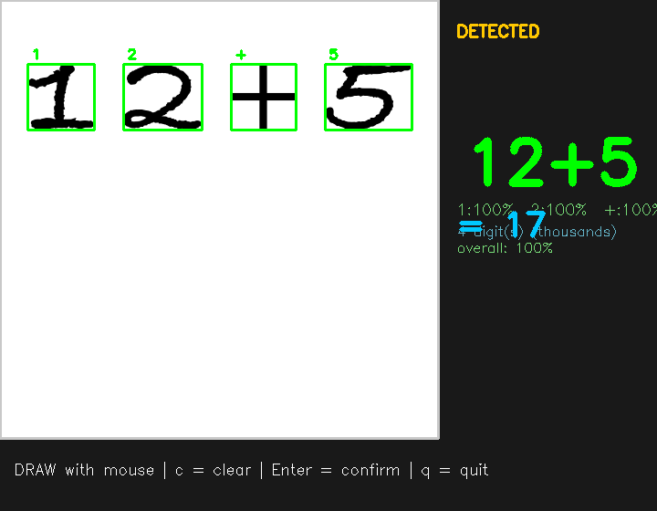
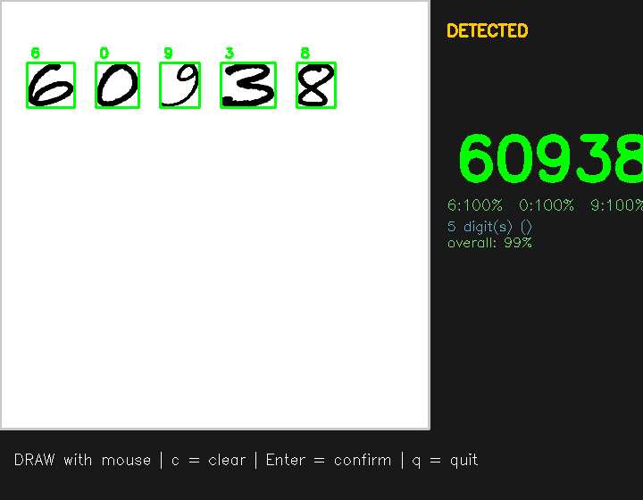

# Smart Classroom - Face & Number Detection

A Python ML application that detects faces in real-time, recognizes handwritten numbers and math, and tracks student performance through profiles and grading.

## Features

- **Face Detection & Recognition**: Detects faces using OpenCV Haar cascades and recognizes registered students via LBPH face recognizer
- **Number Recognition**: CNN trained on MNIST + hand-written-style font rendering to recognize digits (0-9) and `+` / `-` operators
- **Math Pad**: Draw whole expressions like `12+5` or `60938`; the pad segments digits, reads them, and shows the result
- **Big Numbers**: Handles ones up through thousands and beyond, with robustness on confusing digits (0/6, 9/3, 8/3)
- **Connected-Digit Splitting**: Touching or cramped digits are divided automatically (column-gap + valley detection) instead of reading as one blob
- **Student Profiles**: Creates and manages student profiles with answer history
- **Grading System**: Automatic grading (A-F) based on correct answer percentage
- **Drawing Pad**: On-screen drawing canvas for number input
- **Leaderboard**: Ranks students by performance

## Screenshots

| Math pad (`12+5`) | Big numbers (`60938`) |
|---|---|
|  |  |

## Setup

```bash
cd smart-classroom
pip install -r requirements.txt
python main.py
```

## Training the math model

`draw_pad.py` and `app.py` expect `models/expr_model.pth` (12 classes: 0-9, `+`, `-`).
Train it once with:

```bash
python retrain_robust.py
```

It trains on MNIST augmented with rotated/translated samples plus hand-written-style rendered digits and `+`/`-` operators, so it survives real handwriting (including confused-looking 0/6/9/3/8).

## Draw pad

```bash
python draw_pad.py
```

Draw with the mouse. Digits are split by column gaps, so keep a small gap between symbols.
Touching digits are still split automatically when a hairline seam remains.

- `c` clear canvas
- `Enter` confirm prediction
- `q` quit

Examples to try: `7`, `35`, `12+5`, `100-40`, `60938`.

## Controls (main app)

| Key | Action |
|-----|--------|
| `r` | Register a new student |
| `q` | Start quiz mode |
| `t` | Train the number recognition model |
| `l` | View leaderboard |
| `c` | Toggle drawing pad (in quiz mode) |
| `Enter` | Submit drawing / Confirm registration |
| `ESC` | Go back / Quit |

## How It Works

1. **Register Students**: Press `r`, enter ID and name, show face to camera
2. **Train Model**: Press `t` to train the CNN on MNIST (first run only)
3. **Start Quiz**: Press `q`, system picks a random number (0-9)
4. **Draw Answer**: Press `c` to open drawing pad, draw the number
5. **Submit**: Press Enter to recognize the drawing
6. **Profile Updated**: Answer linked to detected face, grade calculated

## Project Structure

```
smart-classroom/
├── main.py                  # Main application
├── app.py                   # Dashboard app (train / test / camera)
├── draw_pad.py              # Drawing pad with digit segmentation
├── retrain_robust.py        # Trains models/expr_model.pth
├── generate_tests.py        # Deterministic test image generator
├── gen_demo.py              # Regenerates the README screenshots
├── config.py                # Configuration
├── requirements.txt         # Dependencies
├── docs/                    # Demo screenshots
├── utils/
│   ├── face_detector.py     # Face detection & recognition
│   ├── number_recognizer.py # CNN number recognition
│   └── profile_manager.py   # Student profiles & grading
├── models/                  # Saved ML models (gitignored)
├── data/                    # MNIST + test data (gitignored)
└── profiles/                # Student profile JSONs
```